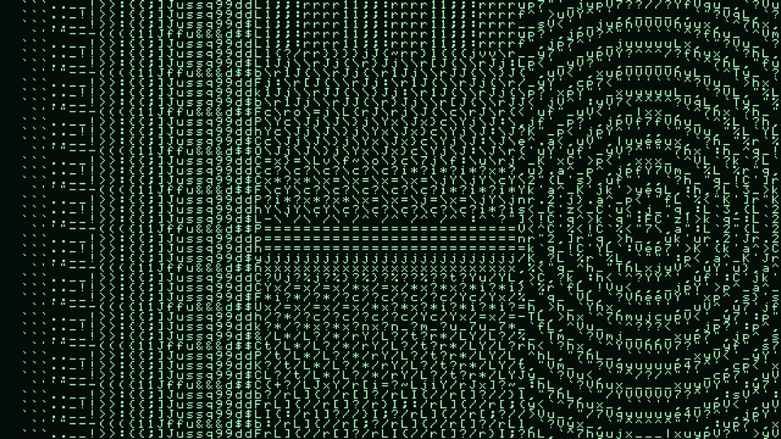

# Asciify user guide

Asciify is **an ASCII art renderer for [Resolume](https://resolume.com) Arena and Avenue**, as an
FFGL effect. It divides the frame into character cells and replaces each one with the character
that stands in for it best.



*The repo's type card at 80 columns, rendered by the plugin's own offline harness in a headless GL context rather than captured from Resolume. A tone ramp on the left, bars at eight angles in the middle, and concentric rings on the right, which is where the shape matching is easiest to see.*

What makes it different from every other ASCII effect is what "best" means. Most of them are a
brightness ramp: measure a cell, look the value up in a hand-written string like
`" .:-=+*#%@"`, print that character. Asciify treats a cell as **a small picture** and matches the
character whose ink is distributed most like it: how much ink there is *and where it sits*. So
edges pick up characters that lean the right way, and a diagonal comes out as slashes rather than
as a smudge of mid-grey punctuation.

> **Before you rely on this:** the character matching is verified numerically. The plugin renders
> at exactly one output pixel per glyph pixel, the chosen characters are read back out of the
> frame, and they're compared against an independent C++ implementation of the same matching:
> 43 runs of 960 cells across every character set, with zero disagreements. Both the macOS
> universal bundle and the Windows x64 DLL build in CI.
>
> Still open: it's **never been loaded into Resolume**. I haven't tested anything about how the
> controls *present* in the host, in particular whether the **Custom Set** text field appears at
> all. Performance has never been measured. Try it on a spare layer before you put it in a show.
>
> This codebase was created with AI assistance, directed and reviewed by a human author.

---

## Installing

Drop the plugin bundle into Resolume's FFGL folder and restart Resolume:

```
macOS    ~/Documents/Resolume Arena/Extra Effects/
         (or /Users/Shared/Resolume Arena/Extra Effects/)
Windows  %USERPROFILE%\Documents\Resolume Arena\Extra Effects\
```

Avenue uses the same layout under its own folder name. Asciify then appears in the effects
browser.

**Needs Resolume Arena or Avenue 7.3.1 or newer.**

The macOS builds are **Developer ID-signed and notarised**, so the bundle just loads, with nothing
to clear and no `xattr` step. The Windows builds aren't code-signed, but plugin files aren't gated
the way `.exe` files are, so Resolume loads them normally, and only the installer trips
SmartScreen, once: **More info** → **Run anyway**.

### OpenFX hosts (Resolve, Vegas, Nuke, Natron)

Asciify also ships as an OpenFX plugin, with the same effect and the same controls. Copy
`Asciify.ofx.bundle` from the `-ofx-` download into the OpenFX folder and
restart the host:

```
macOS    /Library/OFX/Plugins/
Windows  C:\Program Files\Common Files\OFX\Plugins\
Linux    /usr/OFX/Plugins/
```

---

## Start here: Columns and Structure

Two controls do most of the work.

**Columns** is how many characters across, from 8 to 320. Rows follow from it automatically, so
the cells stay square and the characters are never stretched. Coarse is a look; fine is a
rendering technique. Around 60–100 columns reads as a terminal; below 30 the picture becomes an
abstraction; above 200 it starts to read as texture rather than as type.

**Structure** decides how much the *shape* of a cell matters against its *weight*.

- At **0** it's the classic ASCII ramp: every cell gets the character of the correct weight and
  nothing else is considered. There's no separate mode for this; it's what the matching reduces
  to when shape gets no allowance.
- Wind it **up** and the match is allowed to depart from the correct weight in order to get the
  direction right. Edges start choosing `/`, `\`, `|` and `-`; curves get traced.

Most of the visible change happens in the first quarter of the slider. That isn't a fault: the
smallest amount of shape matching is already enough to settle every close call in the ramp, and
the rest of the travel decides how far it may stray in tone.

If you only ever touch two controls, make them these.

---

## The alphabets

The **Characters** control picks which characters are allowed to appear. They behave differently
enough to be worth knowing:

| Set | What it is good for |
|---|---|
| **ASCII** | All 95 printable characters. The default, and the most detail. |
| **Letters** / **Digits** / **Symbols** | Narrower looks. Digits read as a readout; letters as text that is not text. |
| **Classic ramp** | The ten characters everybody uses. A recognisable, coarse, retro look. |
| **Binary** | `0` and `1` only. Two tones, so lean on Dither. |
| **Blocks** | Block elements. The only set that reaches **solid black and solid white**, so it is by far the most photographic — and the best starting point if the ASCII set looks washed out. |
| **Box drawing** | Lines and corners. These all weigh about the same, so this set is chosen almost **entirely** on structure. Turn Structure down here and the picture falls apart, which is the clearest demonstration of what that control does. |
| **Custom** | Whatever you type into **Custom Set**. |

You don't have to order a custom set from dark to light. The plugin measures the ink in every
character it draws and works the ordering out, so `"@#*. "` and `" .*#@"` give exactly the same
picture. Anything the font can't draw is skipped, and an empty result falls back to ASCII rather
than rendering a blank frame.

UTF-8 works, so block characters (`░▒▓█▀▄▌▐`) and box drawing (`─│┌┐└┘├┤┬┴┼╱╲╳`) can be mixed
into a custom set.

---

## Tone, and getting a picture that is not muddy

**Tone** is gamma and **Contrast** is contrast, both with the neutral setting in the *centre* of
the slider rather than at one end. If the render looks flat, these are the first two to reach for.
An ASCII set's heaviest character is only about a third as dark as a solid block, so source
material with a lot of midtone can come out as a uniform field of `u` and `q`.

**Dither** adds an ordered dither of exactly one quantisation step. It doesn't do anything visible
on the 95-character ASCII set, because a step there is tiny. On **Binary**, the **Classic ramp** or
any short custom set it is the difference between a smooth gradient and four hard bands. Turn it
up when the alphabet is small.

**Invert** swaps which end of the picture gets the heavy characters. On is printing on paper; off
is glowing on a tube.

---

## Colour

**Tint** fades the ink between the **Ink** colour and the clip's own colour in that cell. At 0 you
get a monochrome terminal in whatever colour Ink is set to; at 1 the characters carry the picture's
own colours and the effect reads as a mosaic.

**Paper** is what shows behind the characters, and **Paper Opacity** decides whether it's there
at all. Set Paper Opacity to **0** and only the characters composite, and everything behind the
effect shows through the gaps. That's how to put Asciify over other layers rather than in place
of them.

Transparent parts of the clip stay transparent either way. An ASCII render of nothing is nothing,
not a field of spaces on black.

---

## Glyph Edge

**Crisp** keeps the glyph's own pixels, which is what a character on a screen actually was. It's
the right answer whenever the cells are big enough to see.

**Smooth** filters them. Use it when Columns is high enough that the characters are only a few
screen pixels across and the picture starts to shimmer, because crisp pixels at that size alias
badly, especially on moving footage.

---

## Audio reactivity

Resolume can drive any slider here from its own audio analysis: the dropdown beside a
parameter, then **FFT**, a band and a gain. No plugin setting is involved.

- **Columns** on the low band is the one to try first: the whole grid re-rasterises with the
  kick, coarse characters on the hit resolving to fine ones as it decays. Keep the gain
  modest, as the effect is strong.
- **Tone** or **Contrast** on overall level makes the picture itself swell with the mix
  without the grid moving.
- **Dither** on the high band adds churn to the texture when the hats are busy.

Avoid audio-driving **Characters** or **Glyph Edge**: they're dropdowns, and the in-between
values just cut between alphabets.

---

## Troubleshooting

**The effect does nothing.** Almost always a shader that wouldn't compile, which Resolume reports
as nothing at all. Check the log: it names which of the three passes failed, and records the GPU
and driver next to it:

```
macOS    ~/Library/Logs/asciify/asciify.YYYY-MM-DD.log
Windows  %LOCALAPPDATA%\asciify\logs\asciify.YYYY-MM-DD.log
```

**Everything is one character.** The tone range is collapsed. Push Contrast up, and check whether
Invert is fighting the material.

**It looks washed out.** Try the **Blocks** set, which is the only one that reaches solid.

**The Custom Set field isn't there.** It's an `FF_TYPE_TEXT` parameter, which the FFGL SDK
supports and Resolume's own example plugin uses, but nobody has seen it render in Arena yet. If
it's missing, the other eight alphabets all work as normal; please open an issue and say which
version of Resolume you're on.

**It shimmers when the footage moves.** Set Glyph Edge to Smooth, or use fewer columns.

**The plugin never appears.** Almost always the wrong folder, or a Resolume older than 7.3.1.
The macOS builds are signed and notarised, so quarantine isn't the usual answer any more, but a
copy downloaded before that changed may still carry it, and Resolume skips a quarantined plugin
*silently* rather than complaining. `xattr -dr com.apple.quarantine <bundle>` settles it either
way.

---

## See also

- [README](../README.md) — what it is, how it's built, and what is and isn't verified
- [Running unsigned builds](UNSIGNED.md) — Gatekeeper and SmartScreen, in detail
- [AGENTS.md](../AGENTS.md) — the design invariants and the traps, for anyone changing the code
